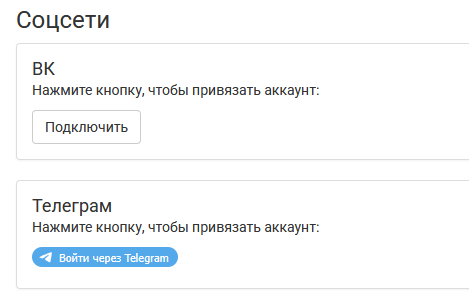
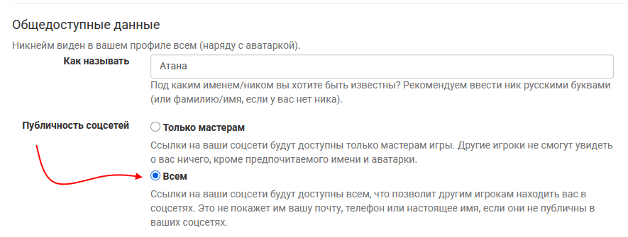
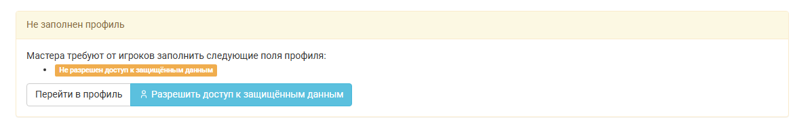
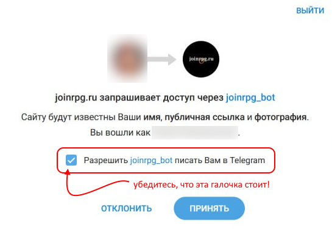
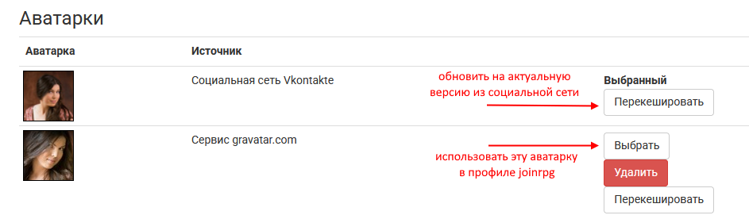

Настройки профиля
==============================

Контакты
------------------

В `вашем профиле <https://joinrpg.ru/manage/setupprofile>`_ есть информация о том, как мастерам с вами связаться. Контакты всегда видны мастерам активных проектов, на которые у пользователя есть неотозванная и неотклоненная заявка. Социальные сети требуется привязать через интерфейс (если вы этого еще не делали и у вас просто внесенные в текстовые поля контакты — советуем подтвердить привязку):

Можно сделать ссылки на социальные сети (ВКонтакте, Телеграм и ЖЖ)  общедоступными. Тогда другие игроки смогут легче вас опознать и связаться с вами без помощи мастеров. 

.. hint:: `Через вводные </plot/special.html>`_ мастера могут показывать контакты игроков друг другу, даже если в профиле они скрыты. Эти контакты также скрываются после закрытия проекта.

Защищённые данные
-----------------

В профиле можно указать паспортные данные, адрес регистрации и дату рождения.
Это защищённые данные: мастера видят их, только если проект их запросил
и вы дали на это согласие в заявке. Обычно они нужны для поселения на турбазе.

Согласие можно дать при подаче заявки или позже, на странице заявки.

Мастера видят только те данные, которые запросил проект. Если проект просит
только дату рождения, паспорт мастера не увидят.

Если проект начнёт запрашивать новые защищённые данные, ваше согласие
отзывается и мастера попросят его снова.

Без согласия мастера видят только ваш возраст, а если вы совершеннолетний —
пометку «Совершеннолетний».

Уведомления в Телеграм 
-----------------------

Привязывая Телеграм, поставьте галочку с разрешением сообщений от @joinrpg_bot (этот экран появится после того, как сервисный аккаунт Телеграм предложит вам подтвердить факт логина на сайте и вы с этим согласитесь):

Теперь раз в день вам будет приходить список ваших заявок, которые были изменены или откомментированы мастерами.

Аватарка 
-----------------------

Советуем установить аватарку: она подтягиватеся из ВКонтакте или Телеграма при привязке вашего аккаунта.

Если вы привязывали ВКонтакте или Телеграм уже давно — нажмите в профиле «Отвязать» и осуществите привязку заново. Если аватарка в соцсетях обновилась и хочется обновить ее и в joinrpg — нажмите «Перекешировать».
